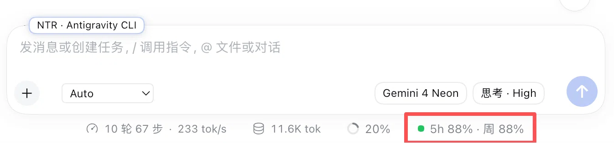
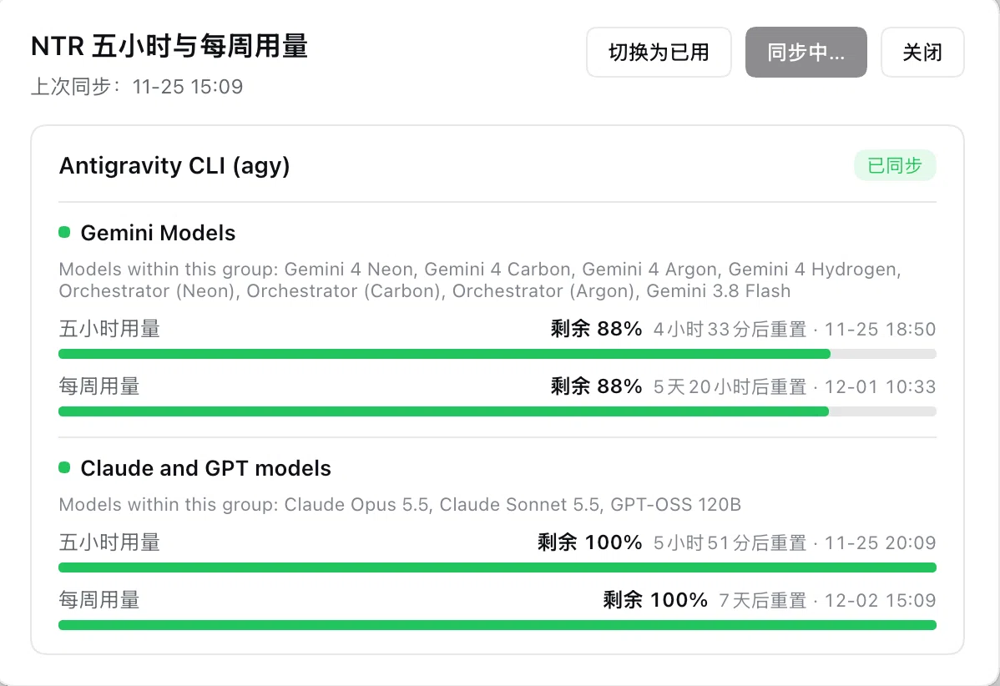

# Gemini Hourglass (`dsh-gemini-hourglass`)

[简体中文](./README.md) | **English**

> Package name: `dsh-ntr-quota` · Watch your NTR 5-hour and weekly quotas flow like sand in an hourglass.

A **DeepSeek Harness (DSH)** companion plugin for **[`dsh-ntr`](https://github.com/GDWhisper/dsh-ntr)** that automatically syncs and displays your ACP agents' **5-hour rolling limits**, **weekly limits**, and exact **reset countdowns** right inside the DSH UI.

## Preview

### 1. Live Composer Dock Pill
Sits cleanly next to the NTR context-occupancy ring, showing the active model group's 5-hour and weekly remaining quota with color-coded warnings and automatic post-turn refresh:



### 2. Multi-Group Detail Popover & Reset Countdowns
Click the dock pill to inspect every model group (`Gemini Models`, `Claude and GPT models`, `Gemini 4 Argon`, etc.) with dual progress bars, exact local reset timestamps, and a one-click **Remaining / Used** toggle:



## Key Features

- **Zero-Token Live Sync**:
  - **Antigravity CLI (`agy`)**: Calls the official `agy -p "/usage" --output-format json` command (`total_tokens: 0`) to fetch all model groups' 5-hour and weekly quotas plus reset timestamps, with plain-text fallback parsing and macOS Electron `PATH` augmentation.
  - **OpenAI Codex (`codex`)**: Automatically reads the latest `rate_limits` snapshot from `~/.codex/sessions` (read-only) when Codex is configured in NTR.
  - **Extensible Provider Architecture**: Add new ACP agent quota adapters cleanly under `src/providers/`.
- **Three Native-Theme UI Surfaces** (adapts automatically to DSH Light/Dark themes):
  1. **Composer Dock Pill (`conversation.composer.dock`)**: Displays `5h XX% · 7d XX%` for the conversation's bound model group right beside NTR's context meter; auto-refreshes with cooldown protection after an NTR turn completes.
  2. **Detail Popover (`shell.overlay`)**: Click the pill for all agents & model groups, dual progress bars, live countdowns, and **Sync Now**.
  3. **Settings Dashboard (`settings.section` → `NTR Quota`)**: Full quota overview, Remaining vs. Used display mode, polling interval (`1m / 3m / 5m / 15m / manual`), and dock visibility (`NTR only / All / Hidden`).
- **Atomic Local Snapshot**: Persists every sync atomically to `~/.dsh/dsh-ntr-quota/snapshot.json` for instant UI hydration on launch and easy consumption by external status bars (SketchyBar, Raycast, etc.).
- **Zero Runtime Dependencies**: Pure Node.js (>= 22) ESM host + DSH Shell ModuleLoader React client — no build step required.

## Installation (DeepSeek Harness Desktop)

> Tip: Run installation when no NTR conversation turn is actively running to avoid triggering a hot-reload mid-turn.

```bash
git clone https://github.com/Duyh814/dsh-gemini-hourglass.git
cd dsh-gemini-hourglass
npm run install:desktop
```

To uninstall:

```bash
npm run uninstall:desktop
```

## Same-Origin HTTP & SSE API

All routes are registered inside DSH's `ctx.connection.fetch` trust boundary:

| Endpoint | Method | Description |
| :--- | :--- | :--- |
| `/api/ntr-quota/state` | `GET` | Returns cached quota snapshot, NTR session-to-model bindings, and settings |
| `/api/ntr-quota/sync` | `POST` | Triggers single-flight sync (`{ force, reason }`; concurrent calls share one run) |
| `/api/ntr-quota/settings` | `POST` | Updates polling interval, Remaining/Used mode, dock visibility, and post-turn sync |
| `/api/ntr-quota/stream` | `GET` | Server-Sent Events stream pushing live updates to all connected clients |

## Testing

```bash
npm test
```

## License

[MIT](./LICENSE)
